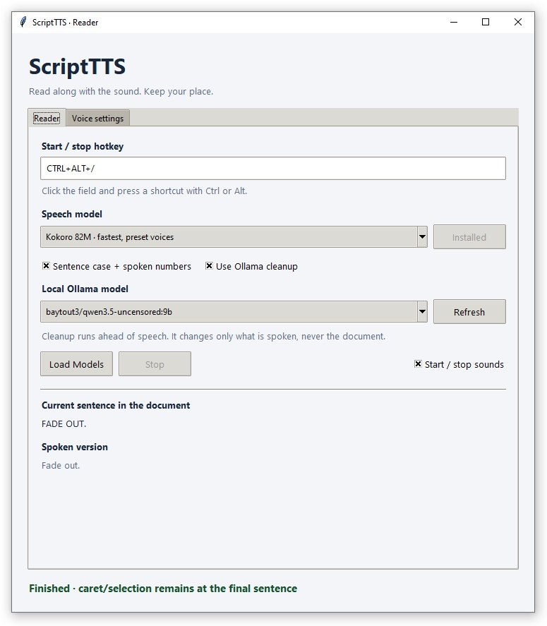
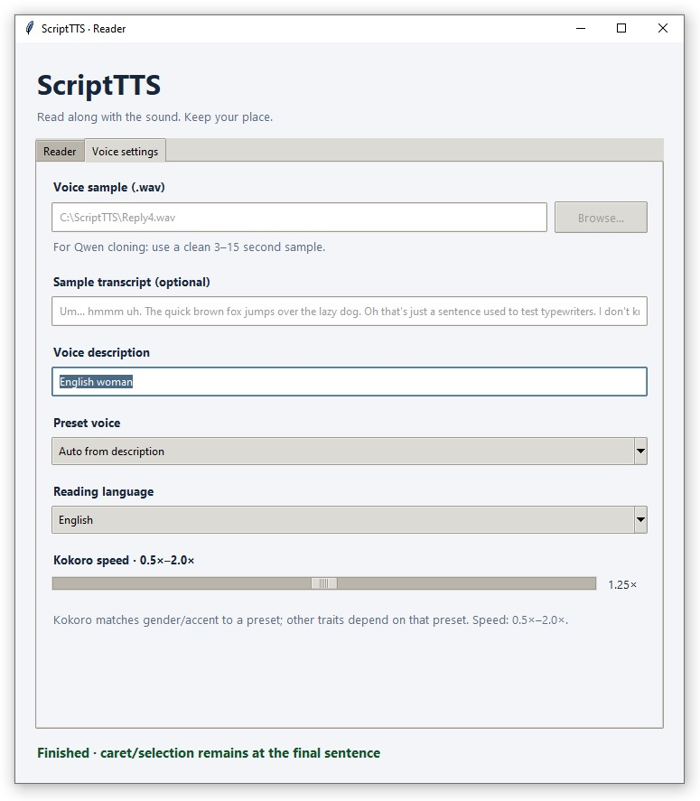

# ScriptTTS

A Windows reader for **LibreOffice Writer (ODT)**, **Notepad (TXT)** and **Chrome PDFs**. It reads from your caret or selection and keeps your place sentence by sentence.

Toggle speech with a global hotkey, use Qwen3 voice cloning or fast preset voices, and optionally prepare spoken text with a local Ollama model. The document marker follows the sentence currently playing while the next sentence is prepared in the background.

**Licensing:** ScriptTTS is licensed under [Apache 2.0](LICENSE). **Models and other third-party components have their own licenses, which may differ from ScriptTTS's license. Read and agree to the applicable model licenses before downloading or using any model**, including models selected through Ollama. See [Licenses and model terms](#licenses-and-model-terms).

## Screenshots

### Reader



### Voice settings



## Start

1. Install **Python 3.12 or 3.13** for Windows, including Tcl/Tk, and add Python to PATH.
2. Download this repository using **Code → Download ZIP** and extract it to a writable folder, or clone it:

   ```powershell
   git clone https://github.com/Steven-Hammon/ScriptTTS.git
   cd ScriptTTS
   ```

3. Double-click **Start Reader.cmd** and review the model license and download prompt.

Double-click **Start Reader.cmd**. Python 3.12 or 3.13 with Tcl/Tk must be installed and available as `python`. Setup creates a private `.venv` beside the application.

The initial default is **Qwen3 1.7B Base**. For a smaller CPU-only first installation, launch Kokoro from PowerShell instead:

```powershell
& ".\Start Reader.cmd" --model kokoro
```

Internet access is needed for the initial Python packages and model downloads. Install LibreOffice, Notepad or Chrome separately for the document type you want to read. Ollama is optional.

Before downloading a model, CMD shows its name, size, Apache 2.0 license link and **1 Agree / 2 Don't agree**. Choosing 2 downloads nothing. Choosing 1 is remembered for that model. Interrupted downloads can be resumed by launching again. After setup, the reader opens without a console window.

Choose a **Speech model** in the reader. Click **Prepare model** if it is not installed; its agreement and download appear in a separate CMD window. Models stay on disk when switching, and only the current inference model stays loaded.

| Model | Download | Voice | Device |
| --- | --- | --- | --- |
| Qwen3 0.6B CustomVoice, optimized | 2.50 GB | Preset voices, no WAV required | NVIDIA CUDA GPU required |
| Qwen3 1.7B Base | 4.54 GB | Clones your reference WAV | NVIDIA CUDA GPU preferred; CPU fallback |
| Qwen3 0.6B Base | 2.52 GB | Faster, smaller voice clone | NVIDIA CUDA GPU preferred; CPU fallback |
| Kokoro 82M, full-precision ONNX | 353.7 MB including voices | Fast preset voices | CPU |

Python runtime packages are additional: Qwen/PyTorch can add several GB. Allow 16 GB of free space for Qwen setup, or 1 GB for Kokoro alone. Both Qwen models include their speech tokenizer. Kokoro alone can be installed without PyTorch using `requirements-kokoro.txt`.

## Read

1. The default hotkey is **CTRL+ALT+/**. To change it, click the **Start / stop hotkey** field and press your preferred combination. The saved shortcut stays visible while you record. Recording ends and focus is released after a valid chord; clicking elsewhere, switching tabs, Tab or Escape cancels recording. Returning to the Reader tab never starts recording. A conflicting shortcut is reported while the existing shortcut remains displayed.
2. For Qwen **Base** voice cloning, choose a clean WAV sample. A 3–15 second sample works best. A matching UTF-8 `.txt` file is loaded as its transcript automatically, or you can type the exact words into **Sample transcript**. Without a transcript, the model uses speaker-embedding cloning. Provide your own reference recording; a cloning sample is not included in this repository.
3. In LibreOffice or Notepad, click where reading should begin. In a Chrome PDF, select the first letter you want to hear.
4. Press the hotkey. Press it again to stop immediately.

While speaking, the reader moves the editing caret to the start of the current sentence. In PDFs, it selects that sentence's first character instead. Stopping leaves that marker in place; restarting repeats the current sentence so you do not skip words. If the initial caret is midway through a sentence, the first reading starts from that exact position.

The **Stop** button also stops playback. Switching to another window stops reading. Document text is never replaced or copied through the clipboard. If you edit a document during reading, restart from the new caret position.

## Kokoro voice and speed

The description defaults to **20 year old woman**. Kokoro matches gender and American/British accent keywords to an existing preset. Age and arbitrary descriptive traits are not independently controllable. You can select an explicit Kokoro voice instead; it overrides the description.

Kokoro does not clone the WAV. The sample remains saved for switching back to Qwen. Qwen Base clones the recording and does not accept a voice-design description.

The **Qwen3 0.6B fast preset** option uses a separate `.fast-venv` runtime with CUDA graphs. It needs an NVIDIA GPU. Its first reading includes model loading and graph preparation; following sentences reuse the warm model. The WAV and Kokoro speed controls are disabled for this option. Choose a named Qwen preset, or let the description pick one: the default female description selects Vivian; a male description selects Aiden. The 0.6B CustomVoice model does not support creating a new voice from a freeform description.

The optimized worker stays loaded between readings. Stopping cancels playback immediately and tells the worker to stop generation at the next streaming chunk. Switching models shuts down the old worker. A Windows job object also closes it automatically if the reader exits unexpectedly.

The Kokoro speed slider covers **0.5×–2.0×**, with **1.0×** as normal speed. Its value is saved. Description and preset controls also work for fast Qwen preset selection; speed is a Kokoro option. English, French, Spanish, Italian and Portuguese are supported in this Kokoro adapter; Qwen also supports the other languages offered in the language menu.

## Playback and privacy

The **Reader** tab now contains text preparation and model loading. **Voice settings** contains the WAV, preset, language and Kokoro speed controls.

**Sentence case + spoken numbers** prepares an English spoken draft, including money, decimals, percentages and ordinals. It affects only the speech sent to TTS. Your original text and its caret offsets remain untouched.

Enable **Use Ollama cleanup**, select an installed local chat model and click **Load Models** to warm up both the selected speech engine and Ollama. **Refresh** reads the local model list at `127.0.0.1:11434`; it does not download a model. Ollama is asked to preserve the text and numeric values, normalize all-caps names, and write dates, times and symbols as spoken words. The current source sentence and its spoken version are shown separately. Thinking is disabled for low latency. You can leave Ollama off to use basic local normalization alone.

Install and run [Ollama](https://ollama.com/) separately, and install a suitable local chat model after reviewing its license. ScriptTTS lists models already available in Ollama; it does not install Ollama or pull chat models. Model-generated cleanup can make mistakes, so compare the spoken preview with the source when accuracy matters. The screenshots show one user's selected model and settings, not required defaults.

Text preparation and TTS have separate workers: while one sentence plays, TTS renders the next and Ollama can prepare the following sentence. The queues are bounded, and stopping cancels pending preparation and discards stale results. A failed Ollama request stops reading instead of silently speaking an unchecked response.

**Load Models** plays no speech. Its status alternates between normal text and **bold dark red** while loading, then becomes **bold dark green** when both models are ready. First use can still include model loading if you start reading without preloading.

Your `Starting.wav` and `Stopped.wav` files play on start and explicit stop. They use the same output stream as speech, so the start cue finishes before the first sentence begins. Turn them off with **Start / stop sounds**.

The caret/selection follows the **audio device's output clock**, including its buffered audio. Preparing or queueing the next sentence cannot advance it. PDF scrolling uses only the first-letter marker, so a long sentence's far end does not pull the view onto the following page.

LibreOffice markers use native text searches validated against the original source, including text containing expanded fields. Plain-text character counts are not used to move Writer's cursor. A marker-position failure is reported without cutting off speech; the reader attempts tracking again on the next sentence. Reaching the final source position cannot end playback until the final audio clip finishes.

The current model stays loaded. Qwen's cloned voice prompt is cached until the WAV or transcript changes. During playback, the reader generates one chunk ahead and starts it as soon as the previous chunk ends. There can still be a gap if generation is slower than playback. Very long sentences are generated in smaller chunks while keeping one sentence marker.

After installation, synthesis is local. Qwen is explicitly put in offline mode; Kokoro uses local model files. Settings, the reference file path and transcript are stored in `data/settings.json`. Model files are in `models/`. Diagnostic errors go to `data/reader.log`.

Chrome PDFs need a selectable text layer exposed through Windows accessibility. Image-only scans require OCR before this reader can use them. Multi-column PDFs follow the order provided by Chrome's text layer.

## Checks

```powershell
.\.venv\Scripts\python.exe -m unittest discover -s tests -v
.\.venv\Scripts\python.exe tests\integration_windows.py libreoffice
.\.venv\Scripts\python.exe tests\integration_windows.py notepad
.\.venv\Scripts\python.exe tests\integration_windows.py chrome
```

The opt-in integration checks create and close disposable documents in the installed applications. They bypass the foreground guard inside the test so you can continue using your computer. They check the real document adapters without downloading a model.

## Model sources

- [Qwen3 1.7B Base](https://huggingface.co/Qwen/Qwen3-TTS-12Hz-1.7B-Base)
- [Qwen3 0.6B Base](https://huggingface.co/Qwen/Qwen3-TTS-12Hz-0.6B-Base)
- [Qwen3 0.6B CustomVoice](https://huggingface.co/Qwen/Qwen3-TTS-12Hz-0.6B-CustomVoice), [optimized inference runtime](https://github.com/andimarafioti/faster-qwen3-tts)
- [Kokoro 82M](https://huggingface.co/hexgrad/Kokoro-82M), [ONNX model release](https://github.com/thewh1teagle/kokoro-onnx/releases/tag/model-files-v1.1)
- [Apache License 2.0](https://www.apache.org/licenses/LICENSE-2.0), also included as `MODEL-LICENSE.txt`

Qwen revisions are pinned. Kokoro downloads are checked against their published SHA-256 digests.

## Licenses and model terms

Copyright 2026 Steven Hammon. ScriptTTS's original application code, documentation and included project assets are distributed under the **Apache License, Version 2.0**. See [LICENSE](LICENSE) for the full terms.

**The application license does not replace the licenses for model weights, speech tokenizers, preset voice data, Python dependencies or inference runtimes. Those components are obtained separately and remain subject to their own upstream terms. Model licenses can differ, especially for user-selected Ollama models. You must read and agree to the applicable licenses before downloading or using those models.**

- Review the Qwen and Kokoro model cards linked above, along with the relevant files and license notices in each upstream repository.
- For Kokoro, also review the [ONNX runtime and asset source](https://github.com/thewh1teagle/kokoro-onnx).
- For optimized Qwen inference, review [faster-qwen3-tts](https://github.com/andimarafioti/faster-qwen3-tts) and its dependencies.
- For Ollama, review the license of **the specific model you choose**. Installing Ollama or accepting ScriptTTS's license does not constitute agreement to every model's terms.

The setup program asks for agreement before downloading its supported TTS models. [MODEL-LICENSE.txt](MODEL-LICENSE.txt) contains the Apache 2.0 text used by that setup prompt; it is not a blanket license for arbitrary models or third-party components. Model weights, installed runtimes, local settings and personal reference recordings are not included in this repository.
